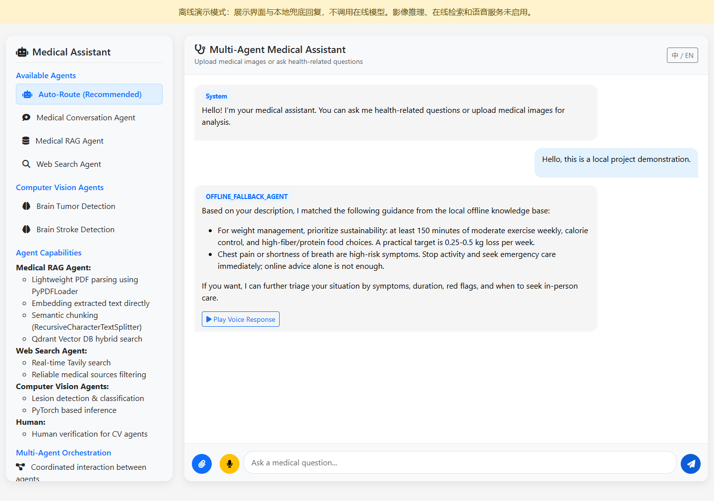

# 本地演示与验证

## 演示范围

本地离线演示用于查看界面、提交文本或上传入口，以及获得现有本地兜底回复。它不执行在线 Agent 图、云端检索、影像推理或语音调用，不能据此判断多代理路由、医学效果或模型质量。

## 启动

在仓库根目录执行：

```powershell
python -m venv .venv
.\.venv\Scripts\python.exe -m pip install -r requirements-offline.txt
.\scripts\start-offline-demo.ps1 -Port 8000
```

脚本优先使用仓库的 `.venv`，设置当前启动进程的离线模式并禁用 dotenv 文件加载，退出后恢复原有环境变量。打开 `http://127.0.0.1:8000/`，停止服务按 Ctrl+C。

健康检查：访问 `/health`，应得到 `status: healthy`、`mode: offline`。

完整在线系统仍需要原有 `requirements.txt`、模型服务配置与数据。本轮未验证完整在线安装或模型工作流。网页样式、图标和 Markdown 脚本仍引用 CDN，界面首次加载可能需要网络。

## 本地回归检查

```powershell
$env:FORCE_OFFLINE_MODE = 'true'
$env:PYTHON_DOTENV_DISABLED = '1'
.\.venv\Scripts\python.exe -m unittest discover -s tests -p test_offline_startup.py -v
```

该测试文件单独运行，包含 8 个测试方法，检查无密钥启动、首页标识、本地聊天、上传入口、在线功能禁用及在线模式仍要求密钥。不要把它与 `test_heyi_remote.py` 混为一轮：后者是连接真实影像服务的测试。

## 2026-11-03 实际验证结果

| 检查 | 结果 | 范围 |
| --- | --- | --- |
| 无密钥启动 | 通过 | 使用现有 Python 3.14.4 环境，未安装整套在线依赖 |
| 离线回归 | 8 个测试通过 | 无外部网络连接；允许 Windows 事件循环使用本机回环连接 |
| 浏览器首页与聊天 | 通过 | Microsoft Edge 无头浏览器，显示离线标识，返回 OFFLINE_FALLBACK_AGENT，无 JavaScript 运行异常 |
| 在线 Agent / RAG / 影像服务 | 未验证 | 不属于本轮离线演示 |
| SQLite 会话恢复与在线路由效果 | 未验证 | 需独立的后续验证 |

本轮使用的主要依赖：FastAPI 0.136.1、Uvicorn 0.46.0、python-multipart 0.0.29、httpx 0.28.1。全新虚拟环境的安装复现尚未单独执行。

## 本次整理中的修复

此前设置 `FORCE_OFFLINE_MODE=true` 仍会在启动时校验在线密钥、导入在线 Agent 依赖。本次个人整理阶段将客户端与 Agent 图改为按需加载，离线模式跳过在线配置；在线专用端点返回 503，并在首页显示模式标识。

这些是 2026-11-03 整理阶段的维护改动，与历史个人负责范围分别记录。


